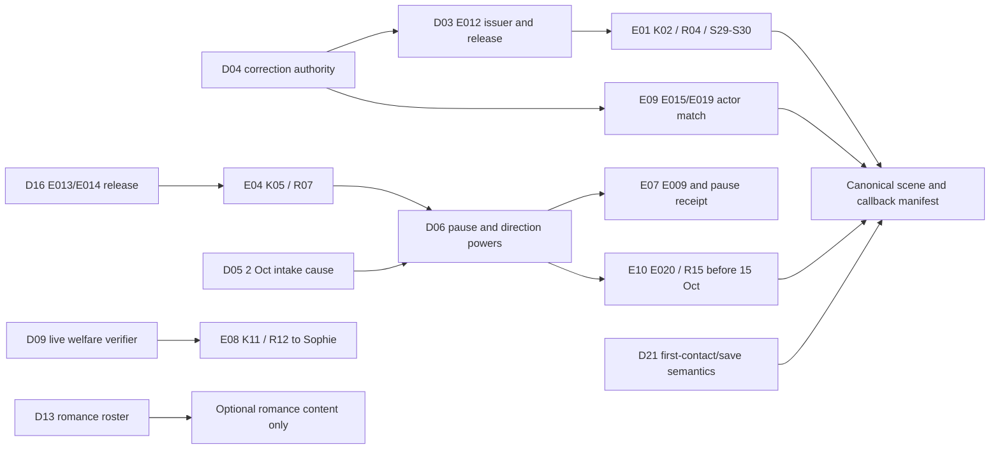

# 04 — dependencies and scenario gate

**Review method:** on-paper trace through [P01 scene catalogs](../phase-01/09_SEASON_01_TEN_EPISODE_OUTLINE.md), [E01 blueprint](../phase-01/10_EPISODE_01_SCENE_BLUEPRINT.md), [evidence](../phase-01/07_EVIDENCE_LEDGER_AND_PROVENANCE.md), [knowledge/receipts](../phase-01/06_KNOWLEDGE_AND_DISCLOSURE_MATRIX.md), and [P01B T01–T10](../phase-01b/08_EVIDENCE_KNOWLEDGE_BRANCH_REGRESSION.md). `PASS` here is documentary consistency only. `PARTIAL` means a decision, source sample, scene fix or executable test remains. `BLOCKED` means no current approved route to the claimed production result. No player/runtime scenario was executed in Phase 01C.

## Decision dependency map

**Phase 02 entry-critical:** D04/D03 for current E01 proof, D05/D06 for the preservation spine, D09 for E08, D16 for low-trust movement proof, and D21 for canonical relationship/save semantics. D13 can be safely held inactive during an E01 vertical slice, but must be settled before optional Season 1 romance content is scripted. Independent scene repairs in [03](03_RECOMMENDED_RESOLUTIONS_WITH_PROVENANCE.md) still need a versioned manifest even after owner choices. Separate process checks are the insurer's A01/A02 release, E012/E013/E014/E020 sample receipts, and a lawful source for the E01-S30 role card.

## T01–T10 rerun on paper

| Scenario | Trace and result | Remaining evidence or action |
|---|---|---|
| **T01 chronology — PARTIAL** | SB2 §§2–3 and P01 [04](../phase-01/04_MASTER_TIMELINE_2019_2026.md) preserve 2019 21:35 → 21:48 → ~22:04 → 22:12–22:39 → 24 Nov 00:18/15:20 → 25 Nov 08:40. E01 opens 8 Oct 2026; P01B [04](../phase-01b/04_PRESERVATION_AND_DEADLINE_PROCEDURE.md) separates 13 Oct pause, 14 Oct direction, 15 Oct check. | D05/D06 must set institution, dated deficiency, signature and expiry. Proposed 10:30/19:10/19:20 hours are not canon. |
| **T02 anonymous/handle tip — PARTIAL** | Approved D18/D19 and P01B [03](../phase-01b/03_AUTHENTICATION_TIP_AND_WORKSPACE_FLOW.md) give both modes R01, Bulletin return token, optional handle, optional messaging and same E012 path. | P01 E01-S11–S16 prematurely uses Messages; S17–S19 lacks a workspace-decline bypass; R03 meaning diverges. Apply [03 editorial fixes](03_RECOMMENDED_RESOLUTIONS_WITH_PROVENANCE.md), then trace both branches through S30 with no auto-Send or identity leak. |
| **T03 skeptical preview — PARTIAL** | E001/E002 remain leads; E003 chronology cannot make Maya's thumbnail authentic. P01B [03](../phase-01b/03_AUTHENTICATION_TIP_AND_WORKSPACE_FLOW.md) requires independently issued E012/R04 before K02. | D04/D03 and a sample lawful same-day export are missing. Without them E01-S29 is **blocked** from marking K02 proved. |
| **T04 Ana refuses public identity — PASS (design invariant)** | A00–A05 in P01B [05](../phase-01b/05_ANA_CONSENT_AND_DISCLOSURE_MATRIX.md) deny public name by default. E012/E013/E014/E018/E009/E015/E019 plus anonymous E006/insurer summary can support the case; E017 and A03–A05 remain optional. Relationship scores cannot grant K07. | This is a paper solvability/privacy pass, **not** release approval. D16 and insurer A01/A02 source terms must be validated before production; every E10 strategy needs a redaction test. |
| **T05 all-low trust, zero romance — PARTIAL** | P01 [06/07/11](../phase-01/11_CHOICE_RELATIONSHIP_AND_BRANCH_RULES.md) offers custodian paths instead of Lucas photo, Nora identity, Daniel admission or high trust. D13 can remain inactive. | D03/D16/D06 release powers and D21 old-zero semantics are open; the full scene graph has not been walked in a runnable build. |
| **T06 device versus welfare — PARTIAL** | P01B [06](../phase-01b/06_DANIEL_WELFARE_AND_LOCATION_PROTOCOL.md) keeps phone fix ≠ person and signed fresh R12 ≠ location. Spoofed relay or phrase alone stays unverified. | D09 verifier/challenge and Sophie wording are open. E08-S11 “safe yes” before release and no-direct-contact S20 need editorial correction. |
| **T07 deadline, denial and fallback — PARTIAL** | 13 Oct `PAUSE-13` is temporary, 14 Oct pending submission lacks legal effect, `DIR-14` plus `ACK-14` would create E020/R15 before 15 Oct; no optional romance/chat can sign it. | D05/D06 powers and receipts missing. The denial/deputy escalation path is **blocked** in current design; do not claim an always-successful hold until it is specified. |
| **T08 unknown credential operator — PASS (negative inference)** | Approved D14/D20 prohibit inferring Vivian or current misuse from E01-S30 role capability. E009 initials remain a lead until E015/E019 later match 2019 approval/publication roles. | This is a paper inference rule. D04 still governs what E015 can prove and whether civilians can see the E01 capability card. |
| **T09 IDs, acquisitions and gates — PARTIAL** | P01/P01B row scan previously found 210 unique scene IDs and 65 investigation supplements; the P01 ledgers enumerate E001–E020 and R01–R15. This review cross-linked affected IDs in [01](01_SOURCE_AND_DECISION_AUDIT.md) and [02](02_OWNER_DECISION_PACK.md). | Counts do not prove a runnable graph. E012/E013/E014/E016/E020 permissions, R03 acceptance semantics and E07/E08 branch exits need manifest tests. |
| **T10 first 20 minutes and spoiler boundary — PARTIAL** | P01B [07](../phase-01b/07_EPISODE_01_FIRST_PLAY_AND_CREDENTIAL_HOOK.md) gives active compare/tip/Maya source-check actions and a late unknown-role E01 hook. No authored UI/gameplay was added here. | Old P01 act minutes conflict with the revised early target. Retime after observation; test first-time comprehension and public asset/notification text for Vivian, Ana, Daniel location, `7-14` meaning and endgame leaks. |

## Gate interpretation

The two documentary `PASS` rows do **not** make Phase 02 ready: they validate bounded privacy/inference propositions only. The seven conditional decisions and D04 remain at the [P01B statuses](../phase-01b/01_OWNER_DECISION_REGISTER_D01_D21.md). An E01 prototype could be scoped separately once D04/D03 and the E01 editorial repairs are approved, but this Phase 01C brief explicitly stops before Phase 02 work. The overall gate remains **NOT READY**.
